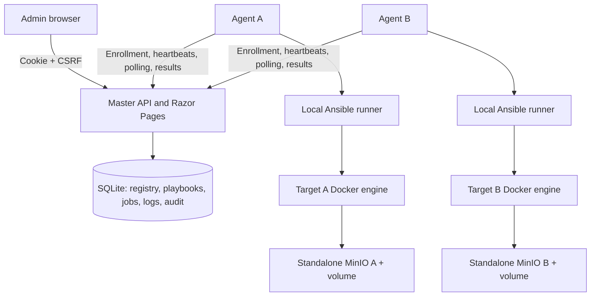

# Dep Pilot

**A deployment control plane built with ASP.NET Core and .NET Worker Services.** Register hosts, execute an approved Ansible playbook locally on each target, and inspect per-host results from one administrative dashboard.

Dep Pilot is a reference implementation for learning and technical assessment review. The included workload is a standalone MinIO instance on each target host. It implements real orchestration and real Ansible execution; the Docker demo simulates two Linux hosts using isolated Docker engines.

## What is included

- ASP.NET Core 10 Master API and responsive Razor Pages dashboard.
- .NET Worker Agent with persistent identity, self-registration, independent heartbeats, and outbound job polling.
- SQLite-backed registry, immutable playbook version, deployments, per-host jobs, logs, and audit events.
- Atomic claims, execution leases, timeout handling, cancellation, credential revocation, and retry-safe result delivery.
- An idempotent Ansible playbook that deploys MinIO with persistent storage and a readiness check.
- Docker Compose demo with two independent simulated hosts, generated secrets, and a source-built MinIO image.
- Automated integration tests, Docker smoke test, CI workflow, architecture notes, API reference, and operations guide.

## Screenshots

View the [screenshot gallery](docs/SCREENSHOTS.md) for the dashboard, deployment output, and audit trail.


## Quick start

Requirements: Docker Engine / Docker Desktop **running Linux containers**, Docker Compose v2.20+, Python 3.10+, internet access for the first build, and approximately 8 GB of memory available to Docker. Windows users can run the Python scripts from PowerShell. A local .NET SDK is unnecessary for the Docker path.

```sh
python scripts/start_demo.py
```

The initial build compiles MinIO from pinned official source and can take several minutes. The script generates credentials, builds the Master and Agent, starts the isolated Docker engines, imports MinIO into each engine, and starts both Agents. Re-running it preserves existing credentials and persistent data.

1. Open **http://localhost:8080**.
2. Sign in as **admin**, using the value in `secrets/admin-password.txt`.
3. Wait for `warehouse-a` and `warehouse-b` to appear online.
4. Select both hosts, enter a deployment name, and select the approved MinIO playbook.
5. Start the deployment and inspect each host's result and output.

After deployment:

| Target | S3 endpoint | Console |
|---|---|---|
| warehouse-a | http://localhost:19000 | http://localhost:19001 |
| warehouse-b | http://localhost:29000 | http://localhost:29001 |

MinIO username: `dep-pilot`. Password: the value in `secrets/minio-password.txt`. The pinned community edition has a limited console; S3 readiness is the primary automated check.

Run the complete demo verification:

```sh
python scripts/smoke_test.py
python scripts/failure_scenarios.py
```

The smoke test verifies two registered Agents, successful deployments, MinIO readiness, authenticated S3 upload/download, a second run with `changed=0`, omission of configured credentials from job output, Master restart persistence, and object persistence across MinIO restarts. The failure scenarios stop only the demo's Agent B, verify heartbeat expiry and offline queued-job cancellation, then restore the Agent and confirm its identity and cancellation state. Run these against a disposable local demo with no active deployment work.

To run alongside another demo, copy `.env.example` to `.env` and choose unused ports. The scripts resolve the effective Master and MinIO ports from Compose configuration. `.env` and generated credentials are excluded from Git. Default published ports are listed above; your local overrides take precedence.

```sh
docker compose logs -f master agent-a agent-b
docker compose stop
docker compose up -d
```

Use the start script again if a simulated engine's data volume has been recreated, because that engine needs its MinIO image reimported. `docker compose down` removes containers and networks but preserves named volumes. MinIO instances remain inside the engine volumes while the outer stack is stopped. See [operations](docs/OPERATIONS.md) before removing volumes.

## Architecture



The Master is one modular application. The Agents are separate deployable processes. Agents need no inbound application port. SQLite is appropriate for the single-Master assessment; the code does not claim support for multiple concurrent Master instances.

## Local .NET development

Install the .NET 10 SDK. The Master can run on Windows, Linux, or macOS; actual playbook execution requires a Linux Agent environment with Ansible and Docker access.

```sh
dotnet restore
dotnet build -c Release
dotnet test -c Release
python scripts/init_secrets.py
```

For a loopback-only Master on PowerShell:

```powershell
$env:Master__AllowInsecureHttp = 'true'
$env:Master__DatabasePath = "$PWD/work/local-master.db"
$env:DEP_PILOT_ADMIN_PASSWORD_FILE = "$PWD/secrets/admin-password.txt"
$env:DEP_PILOT_BOOTSTRAP_TOKEN_FILE = "$PWD/secrets/bootstrap-token.txt"
$env:ASPNETCORE_URLS = 'http://127.0.0.1:8080'
dotnet run --project src/DepPilot.Master
```

For a native Linux Agent, set `Agent__MasterUrl`, secret file paths, `Agent__StateDirectory`, and the target's MinIO settings as described in [configuration](docs/CONFIGURATION.md). Build and load the pinned MinIO image into that host's Docker engine first. Install the Ansible collection from `playbooks/requirements.yml`.

## Repository map

```text
src/DepPilot.Master/      API, security, persistence, job lifecycle, admin UI
src/DepPilot.Agent/       Enrollment, heartbeats, execution, result recovery
src/DepPilot.Contracts/   Shared transport messages and job statuses
tests/DepPilot.Tests/     API integration, concurrency, and execution tests
playbooks/                  Approved MinIO playbook and collection versions
docker/                     Master, Agent, and source-built MinIO images
scripts/                    Secret initialization, demo startup, smoke verification
docs/                       Architecture, APIs, security, operations, and review notes
.github/workflows/          Build/test and full Docker demo verification
```

## Design choices and boundaries

- **Pull-based REST:** outbound connectivity and simple debugging, with five-second polling rather than a broker.
- **Durable jobs:** the database is the queue; HTTP requests never execute deployments themselves.
- **No automatic redispatch:** a lost lease becomes `TimedOut`. Operators inspect local state before explicitly creating another deployment.
- **One active job per host:** concurrent API requests cannot queue conflicting work for the same host.
- **Approved playbooks only:** the initial version seeds one trusted playbook; arbitrary upload or remote shell commands are deliberately outside the implemented scope.
- **Output after execution:** bounded, sanitized Ansible output is uploaded when execution finishes; status and host availability update during execution.
- **Local-demo transport:** Compose explicitly opts into HTTP, binds web ports to loopback, and isolates plaintext Docker APIs on separate bridges. Real deployments require HTTPS and appropriate Docker access controls.
- **MinIO availability:** the community project is archived and legacy image availability changed. The demo builds the requested workload from official commit `9e49d5e7a648f00e26f2246f4dc28e6b07f8c84a` rather than depending on vanished registry tags. Review its maintenance and licensing before any production use.

## Documentation

| Document | Purpose |
|---|---|
| [Architecture](docs/ARCHITECTURE.md) | Components, data flow, consistency, and failure behavior |
| [API reference](docs/API.md) | Authentication, endpoint contracts, and examples |
| [Configuration](docs/CONFIGURATION.md) | Settings, secret files, and native deployment |
| [Security](docs/SECURITY.md) | Trust boundaries, implemented controls, and limitations |
| [Operations](docs/OPERATIONS.md) | Runbook, troubleshooting, backups, and recovery |
| [Assessment mapping](docs/ASSESSMENT.md) | Requirement coverage, demo plan, and tradeoffs |
| [Validation](docs/VALIDATION.md) | Evidence and verification instructions |
| [Commit guide](docs/COMMIT_GUIDE.md) | Logical commit structure and review order |

This is an independent educational reference project with no vendor affiliation. Third-party software keeps its own license. See [third-party notices](THIRD_PARTY_NOTICES.md).
