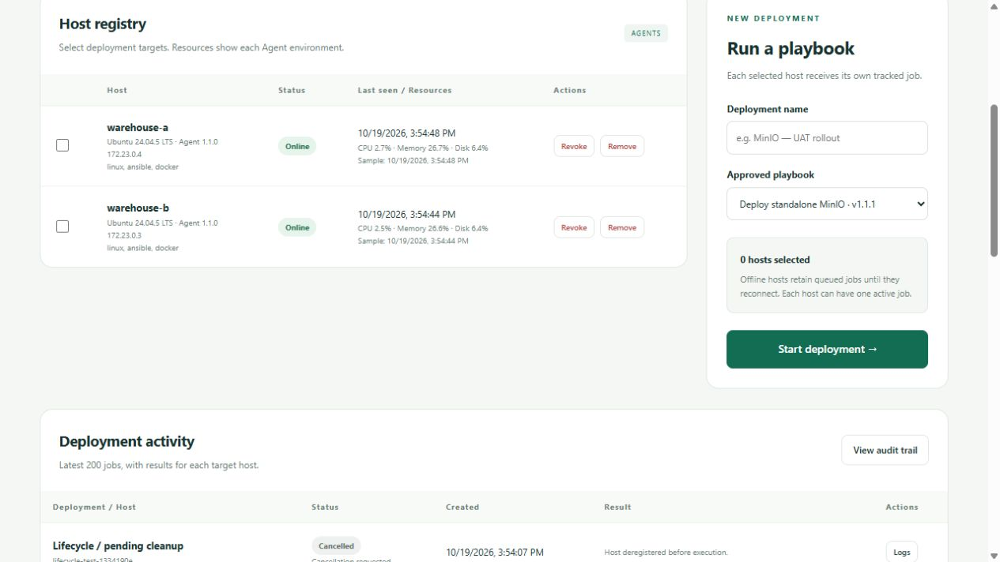

# Dep Pilot

A .NET deployment system that manages hosts and deploys standalone MinIO instances through Ansible. View host resources, deployment results, logs, and audit history from one dashboard.

## How it works

1. Agents register with IP/capabilities and send heartbeats with CPU, memory, and disk usage.
2. An administrator selects hosts and starts a deployment.
3. Each Agent runs the approved playbook locally, reports its result, and restores the previous MinIO configuration if installation fails.

**Stack:** ASP.NET Core 10, .NET Worker Service, Razor Pages, SQLite, Ansible, and Docker Compose.

## Preview



[View deployment logs and audit screenshots](docs/SCREENSHOTS.md).

## Try the demo

Requires Docker running Linux containers, Docker Compose v2.20+, Python 3.10+, and internet access for the first build. Allow about 8 GB of memory for Docker. A local .NET SDK is not required for this demo.

From the project folder:

```sh
python scripts/start_demo.py
```

The first build can take several minutes. It creates local credentials, an HTTPS certificate, and two simulated Linux hosts. For browser access, trust your generated `secrets/master.crt` in your local user certificate store; Agents and test scripts already trust this certificate. Never share its private key.

1. Open **https://localhost:8080**.
2. Sign in as **admin** using `secrets/admin-password.txt`.
3. Wait for both hosts to appear online.
4. Select the hosts, name the deployment, and run the MinIO playbook.
5. Open the job logs to inspect the result.

After deployment:

| Host | MinIO S3 API | Console |
|---|---|---|
| warehouse-a | http://localhost:19000 | http://localhost:19001 |
| warehouse-b | http://localhost:29000 | http://localhost:29001 |

MinIO username: `dep-pilot`. Password: `secrets/minio-password.txt`. Each installation generates its own credentials. Copy `.env.example` to `.env` to change ports.

Stop the demo with `docker compose stop`; stored data is preserved.

## Tests

With the .NET 10 SDK:

```sh
dotnet test DepPilot.sln -c Release
```

See [validation](docs/VALIDATION.md) for Docker tests and full demo checks.

## Documentation

| Document | Contents |
|---|---|
| [Architecture](docs/ARCHITECTURE.md) | Components and system flow |
| [API](docs/API.md) | Endpoints and authentication |
| [Agent installation](docs/INSTALLATION.md) | Self-contained Linux/Windows service setup |
| [Deployment packages](docs/PACKAGES.md) | Approved playbooks and application templates |
| [Configuration](docs/CONFIGURATION.md) | Ports, credentials, and settings |
| [Operations](docs/OPERATIONS.md) | Commands and troubleshooting |
| [Security](docs/SECURITY.md) | Controls and limitations |
| [Validation](docs/VALIDATION.md) | Test results and commands |
| [TODO](docs/TODO.md) | Ideas for industrial use |

Original code is rights reserved; see [LICENSE-NOTICE.md](LICENSE-NOTICE.md). Third-party licenses are listed in [THIRD_PARTY_NOTICES.md](THIRD_PARTY_NOTICES.md).
