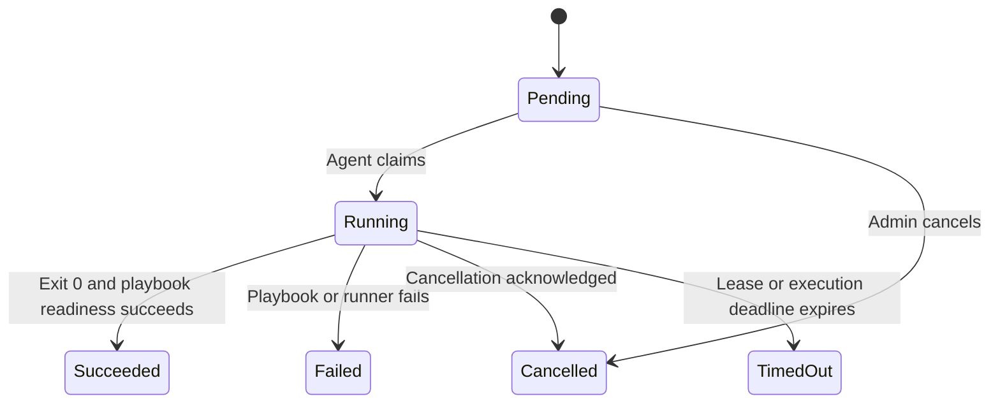

# Architecture and decisions

## System responsibility

Dep Pilot coordinates trusted deployment instructions across registered hosts. It does not proxy application data: clients use each deployed MinIO endpoint directly. Each target runs an independent standalone MinIO instance, not a distributed MinIO storage cluster.

## Components

The Master hosts HTTP endpoints, Razor Pages, an EF Core persistence layer, and a lease-expiration background service. `DeploymentService` owns job creation, claims, renewals, completion, cancellation, and revocation. API handlers handle transport and authentication; the service enforces lifecycle rules.

The Agent contains two independent background services. `AgentWorker` enrolls, polls, executes, and reports results. `HeartbeatWorker` continues reporting availability while a long playbook runs. `MasterClient` owns HTTP transport, `AgentState` owns local recovery files, and `PlaybookRunner` owns process execution and output sanitization.

The shared contracts project contains DTOs and statuses only. It carries no database or execution implementation.

## Enrollment and identity

1. Before contacting the Master, the Agent generates a random 256-bit token and installation ID and atomically persists them.
2. A bootstrap bearer credential authorizes registration; the body contains the proposed Agent token.
3. The Master stores a SHA-256 hash of that high-entropy token and issues a host ID.
4. Repeating the same enrollment is safe if the initial response is lost. Reusing the installation ID with another token is rejected.
5. Subsequent requests use the per-Agent token. The bootstrap token is never accepted on normal Agent endpoints.

An installation ID is an identity key, not a hostname. Reinstalling without restoring the identity creates a new host. A revoked identity cannot silently enroll again.

## Deployment sequence

```mermaid
sequenceDiagram
    participant Admin
    participant Master
    participant DB as SQLite
    participant Agent
    participant Ansible
    Admin->>Master: Create deployment (cookie + CSRF)
    Master->>DB: Validate targets; insert deployment and jobs
    Agent->>Master: Claim work (Agent bearer token)
    Master->>DB: Atomic claim, attempt ID, lease
    Master-->>Agent: Version and expected playbook hash
    Agent->>Master: Download owned job's playbook
    Agent->>Agent: Verify SHA-256
    Agent->>Ansible: Execute local playbook without shell
    loop During execution
        Agent->>Master: Renew lease every 10 seconds
        Master-->>Agent: Cancellation flag
    end
    Ansible-->>Agent: Exit code and bounded output
    Agent->>Agent: Persist sanitized pending result
    Agent->>Master: Upload ordered output chunks
    Agent->>Master: Complete using attempt ID
    Master->>DB: Store terminal result and audit event
```

## Persistence and consistency

| Entity | Role |
|---|---|
| ManagedHost | Stable installation ID, host metadata, credential hash, last heartbeat, revoked flag |
| Playbook | Immutable name/version/content/hash tuple |
| Deployment | Administrative request, playbook version, actor, creation time |
| DeploymentJob | Per-host status, attempt, lease, cancellation, timestamps, result |
| JobLog | Ordered, deduplicated output chunks |
| AuditEntry | Enrollment, deployment, claim, completion, cancellation, and revocation events |


## Job lifecycle




## Failure behavior

| Failure | Behavior |
|---|---|
| Host offline before claim | Pending work waits; no pending-job deadline is implemented |
| Master temporarily unavailable | Agent polls again with jitter; heartbeat retries independently |
| Lease renewal fails | Agent stops local execution conservatively |
| Agent process crashes | Master times the job out; the job is not automatically requeued |
| Result response lost | Persisted result is retried; duplicate terminal completion is safe |
| Result arrives after timeout | Rejected and retained locally as a quarantined result |
| Admin cancels running work | Agent learns on renewal and terminates the process tree |
| Credential revoked | Further Agent API access is denied; running work stops when renewal fails |
| Master restarts | Database jobs and persisted cookie keys survive |
| MinIO fails readiness | Playbook exits unsuccessfully and job is marked failed |
