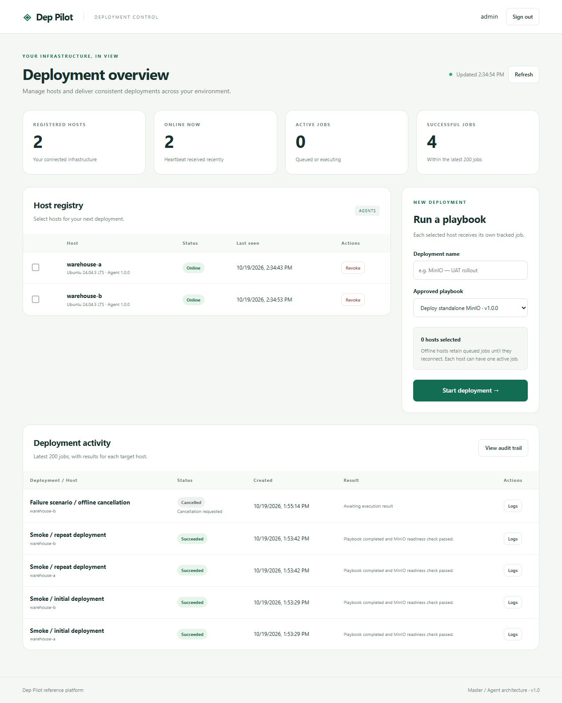
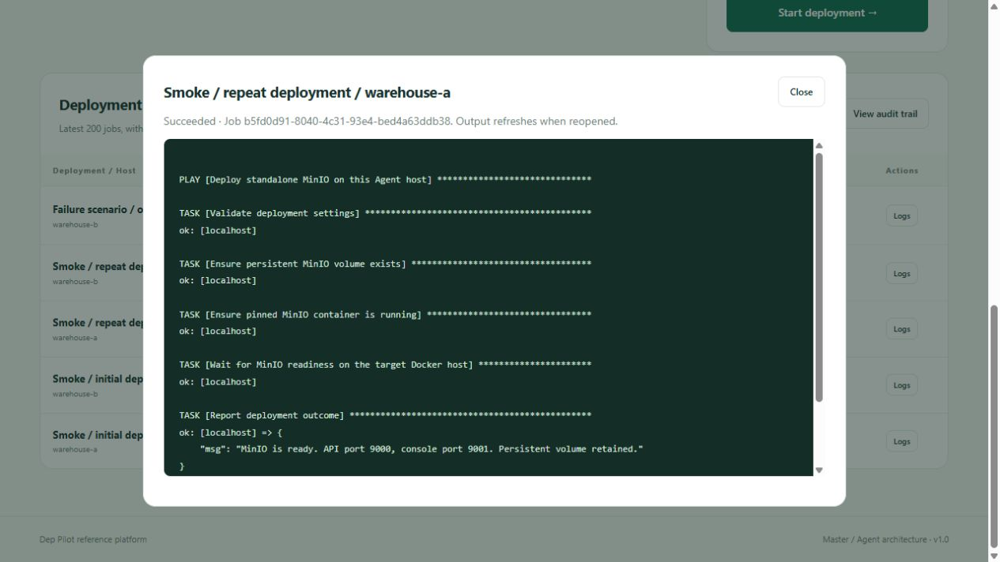
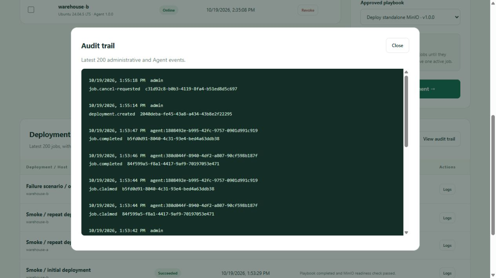

# Dep Pilot screenshots

Screenshots captured from a local, two-Agent Docker demo. These images are for reference; host names, timestamps, and deployment results reflect that test session. Your local environment will have its own credentials and deployment history.

## Dashboard

The administrative dashboard shows registered hosts, heartbeat availability, deployment controls, and per-host job history.

## Deployment output

The job detail dialog displays the Ansible output returned by the target Agent after execution.

## Audit trail

The audit dialog records administrative actions and Agent job lifecycle events, including deployment creation, job claims, completion, and cancellation requests.

See the [project README](../README.md) for setup and usage instructions. Screenshots do not contain login passwords or enrollment tokens.
