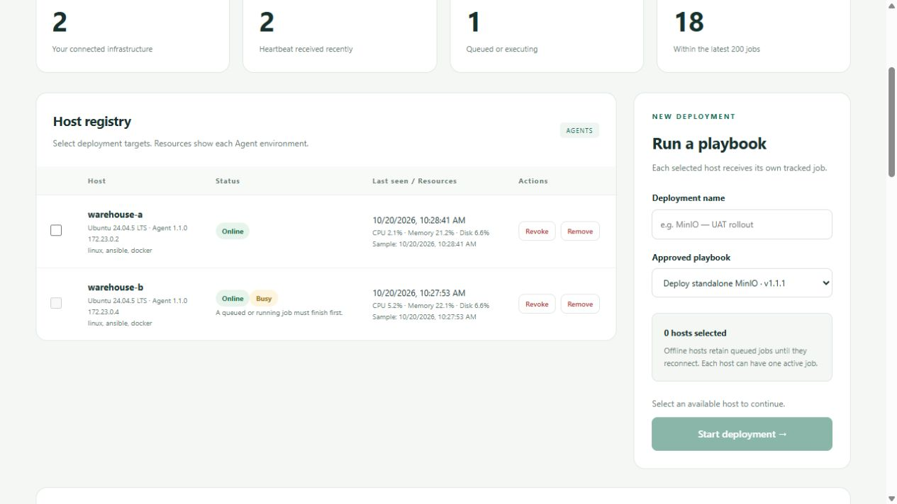

# Dep Pilot screenshots

Screenshots captured from the local HTTPS demo with two Agents. Resource values describe each Agent environment.

## Dashboard

## Host resources

## Deployment controls

Busy hosts are locked while work is queued or running. Select available hosts and enter a name to enable deployment.

## Deployment output

## Audit trail

